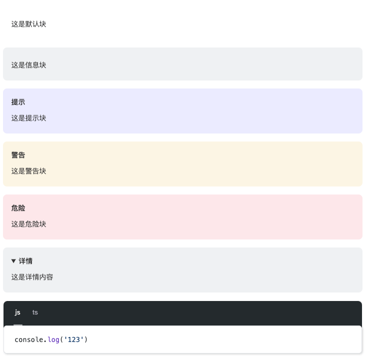

<div align="center">

<h1>remark-block-containers</h1>

[](https://www.npmjs.com/package/remark-block-containers)
[](https://www.npmjs.com/package/remark-block-containers)
[](https://bundlephobia.com/result?p=remark-block-containers)

[English](./README.md) · 中文

这是一个 remark 插件，用于创建自定义容器，允许添加标题、id或样式类。
</div>

## ❓什么时候应该使用？

如果您想要在 markdown 中添加自定义容器，例如生成警告、详情、危险、提示框等。

- 允许自定义标签类型
- 允许添加id或者样式类
- 允许自定义标签标题
- 已内置 `info`、`tip`、`warning`、`danger`、`details`、`code-group` 便捷写法

## 📦 安装

该软件包仅适用于 ESM。要求 Node.js 版本 18+

```bash
npm install remark-block-containers
```
或者
```bash
yarn add remark-block-containers
```
或者
```bash
pnpm add remark-block-containers
```

## 📄 用法

`::: [type][{id|class}] [title]`

假设有如下 markdown 文件，`example.md` 它包含一个灵活的容器，类型为 tip。
注意：每个容器必须以三个冒号开始和结束；并且*两个相邻的容器中间必须有空行*。

```markdown
<!-- 必须需要一空行 -->
::: tip 提示
这是一条提示。
:::
<!-- 必须需要一空行 -->
```

并且有一个 `example.js` 文件包含：

```javascript
import { unified } from 'unified'
import { read } from 'to-vfile'
import remarkParse from 'remark-parse'
import remarkRehype from 'remark-rehype'
import rehypeStringify from 'rehype-stringify'
import rehypeFormat from 'rehype-format'
import remarkBlockContainers from 'remark-block-containers'

const file = await unified()
  .use(remarkParse)
  .use(remarkBlockContainers)
  .use(remarkRehype)
  .use(rehypeFormat)
  .use(rehypeStringify)
  .process(await read('example.md'))

console.log(String(file))
```

运行后 `node example.js` 会得到👇

```html
<div class="block-default tip">
  <p class="block-title">提示</p>
  <p>这是一条提示。</p>
</div>
```

> `info`、`tip`、`warning`、`danger`、`details`、`code-group` 等 type 都是内置便捷写法，等价于 `::: p{.tip}`。
>
> 若想要添加**自定义id**，则 `::: p{#id}` 即可。
>
> 因此你想要自定义任何容器也是允许的，**前提 `type` 是合法标签类型**，如 `div`、`main`、`span` 等。

### 可选样式

**默认所有容器都是没有样式的**，因此你可以**自行设置容器样式**或使用**预设样式**：

```javascript
// 引入预设样式表
import 'remark-block-containers/css'
```



### 代码组

**使用 `code-group` 时**，单一引用该插件的是不行的，无法实现切换逻辑，因此需要在恰当的位置，**引入 `useCodeGroups.js` 并执行 `useCodeGroups` 方法**，监听代码组 `tab` 点击实现切换逻辑。

```javascript
import { useCodeGroups } from 'remark-block-containers/useCodeGroups'
useCodeGroups()
```

### ❗ 注意事项

目前存在一个问题，当容器只有没有任何内容时，会被误解析为非容器，因此尽量避免这种做法。

```markdown
:::
:::
```

## ⚙️ 选项

所有选项都是可选的。

```javascript
use(remarkBlockContainers, {
  containerClass: 'block-default', // 容器默认样式类
  containerType: 'div', // 容器标签类型，只影响便捷写法。
  titleType: 'p', // title 标签类型
  titleClass: 'block-title', // title 默认样式类
})
```

也可直接使用默认选项

```javascript
use(remarkBlockContainers)
```

## License

[MIT](https://github.com/leezhian/remark-block-containers) © [leezhian](https://github.com/leezhian)